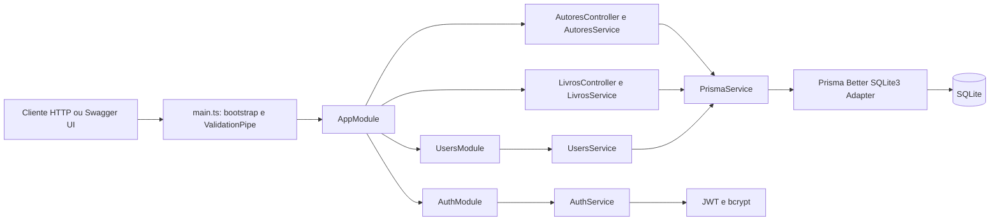

# API de autores e livros

API REST para cadastro e consulta de usuários, autores e livros. A aplicação usa NestJS, Prisma e SQLite; algumas rotas exigem um JWT Bearer.

## Tecnologias

| Tecnologia | Uso |
|---|---|
| Node.js e TypeScript | Runtime e linguagem da aplicação. O projeto usa módulos ES (`"type": "module"`). |
| NestJS 12 | Estrutura da API, injeção de dependências, módulos, controllers e serviços. |
| Express | Adaptador HTTP via `@nestjs/platform-express`. |
| Prisma 7 | ORM, schema, migrations e geração do client. |
| SQLite | Banco relacional local. |
| `better-sqlite3` e `@prisma/adapter-better-sqlite3` | Driver e adapter SQLite usados pelo Prisma Client. |
| `@nestjs/jwt` | Geração e verificação de tokens JWT. |
| `bcrypt` | Hash de senhas com custo 10 no cadastro. |
| `@nestjs/swagger` | Geração e interface interativa da especificação OpenAPI. |
| `class-validator` e `class-transformer` | Validação e transformação de DTOs integradas ao `ValidationPipe`; as validações dependem dos decorators existentes em cada DTO. |
| `@nestjs/config` e `dotenv` | Acesso à configuração e carregamento de variáveis do arquivo `.env`. |
| Vitest e Supertest | Testes unitários e HTTP/e2e. |
| Oxlint e Prettier | Lint e formatação do código. |
| RxJS e `reflect-metadata` | Dependências utilizadas pelo ecossistema NestJS. |

As versões exatas e scripts estão definidos em [`package.json`](package.json) e [`package-lock.json`](package-lock.json).

## Pré-requisitos

- Node.js e npm instalados.
- Um terminal com `openssl` para gerar uma chave JWT segura.

O projeto não declara uma versão mínima de Node.js no `package.json`.

## Configuração local

1. Instale as dependências:

   ```bash
   npm ci
   ```

2. Crie seu arquivo de ambiente a partir do modelo:

   ```bash
   cp .env.example .env
   ```

3. Preencha o `.env` com os valores locais. O arquivo `.env.example` contém as variáveis, mas seus valores são vazios:

   ```env
   DATABASE_URL="file:./dev.db"
   SECRET_KEY=""
   PORT=3000
   ```

   Gere uma chave para `SECRET_KEY` e cole o resultado no `.env`:

   ```bash
   openssl rand -hex 32
   ```

   `DATABASE_URL` aponta para o arquivo SQLite usado pela aplicação. `PORT` é opcional e, quando ausente, a API usa a porta `3000`. Não use uma chave de desenvolvimento em produção.

4. Gere o Prisma Client e aplique as migrations existentes:

   ```bash
   npx prisma generate
   npx prisma migrate dev
   ```

   A configuração do Prisma está em [`prisma.config.ts`](prisma.config.ts), o schema em [`prisma/schema.prisma`](prisma/schema.prisma) e o histórico de migrations em [`prisma/migrations`](prisma/migrations).

5. Inicie a API em modo de desenvolvimento:

   ```bash
   npm run start:dev
   ```

6. Acesse:

   - API: `http://localhost:3000` (ou a porta definida em `PORT`).
   - Swagger UI: `http://localhost:3000/docs` (ou a mesma porta da API).

   A documentação OpenAPI anuncia o endereço local com a variável `PORT` e o nome **Servidor Local**. No Swagger, use **Authorize** e informe o token JWT para testar endpoints protegidos.

## Arquitetura

A aplicação segue a organização modular do NestJS. Controllers recebem requisições HTTP e encaminham o trabalho aos serviços; serviços implementam as operações e usam o `PrismaService` para persistência.



## Executar com Docker Compose

Na raiz do repositório, crie `project/.env` a partir do exemplo e defina uma chave JWT:

```bash
cp project/.env.example project/.env
openssl rand -hex 32
```

Copie o valor gerado para `SECRET_KEY` em `project/.env`. Depois, suba a API e a interface:

```bash
docker compose up --build
```

A interface fica disponível em `http://localhost:5173`, a API em
`http://localhost:3000` e a documentação Swagger em `http://localhost:3000/docs`.
O banco SQLite é mantido no volume `project_data`; as migrations são aplicadas
quando a API inicia. Para encerrar, use `docker compose down`. Para apagar também
o banco persistido, use `docker compose down -v`.

### Componentes

- `src/main.ts`: carrega variáveis de ambiente, cria a aplicação NestJS, registra `ValidationPipe`, configura Swagger e inicia o servidor.
- `src/app`: módulo raiz da aplicação.
- `src/auth`: login, cadastro pelo endpoint `/auth/register`, emissão de JWT e `AuthGuard`.
- `src/users`: operações de usuário e hashing de senha.
- `src/autores`: operações de autores.
- `src/livros`: operações de livros.
- `src/prisma`: módulo global e serviço que conecta o Prisma Client ao SQLite.
- `src/generated/prisma`: Prisma Client gerado a partir do schema.
- `prisma/schema.prisma`: modelos `users`, `autores` e `livros`, relacionamentos e regras de exclusão em cascata.
- `test` e arquivos `*.spec.ts`: testes unitários e e2e.

## Como uma requisição funciona

1. `main.ts` carrega o `.env`, configura a validação global e monta a especificação Swagger.
2. O NestJS encaminha a requisição ao controller correspondente (`auth`, `users`, `autores` ou `livros`).
3. Nas rotas com `AuthGuard`, o guard lê `Authorization: Bearer <token>`, verifica o JWT com `SECRET_KEY` e disponibiliza o payload em `request.user`.
4. O controller passa os parâmetros e o body ao serviço. O DTO determina o schema mostrado no Swagger; as validações em runtime dependem de decorators `class-validator` presentes no DTO.
5. O serviço executa a regra da operação e acessa os dados pelo `PrismaService`.
6. O Prisma Client usa o adapter `better-sqlite3` para consultar ou alterar o arquivo SQLite e o resultado volta como resposta HTTP.

### Fluxo de autenticação

1. Cadastre uma conta em `POST /auth/register` ou `POST /users`.
2. Envie `email` e `password` para `POST /auth/login`.
3. A resposta de login contém `access_token`. O token é assinado para expirar em uma hora.
4. Envie o token nas rotas protegidas: `Authorization: Bearer <access_token>`.

O cadastro armazena a senha com bcrypt; a resposta de cadastro seleciona apenas `id`, `nome` e `email`. O payload do JWT contém o identificador do usuário em `sub`.

## Endpoints

Consulte `/docs` para os schemas, exemplos e respostas documentadas. Resumo das rotas expostas pelos controllers:

| Método | Rota | Autenticação | Descrição |
|---|---|---|---|
| `POST` | `/auth/register` | Não | Cadastra usuário pelo módulo de autenticação. |
| `POST` | `/auth/login` | Não | Autentica usuário e retorna `access_token`. |
| `PATCH` | `/auth/:id` | Não | Atualiza usuário pelo módulo de autenticação. |
| `DELETE` | `/auth/:id` | Não | Remove usuário pelo módulo de autenticação. |
| `POST` | `/users` | Não | Cadastra usuário pelo módulo de usuários. |
| `GET` | `/users/:id` | Bearer | Consulta usuário; atualmente retorna `null` se não existir. |
| `PATCH` | `/users/:id` | Bearer | Atualiza usuário. |
| `POST` | `/autores` | Bearer | Cadastra autor associado ao usuário do token. |
| `GET` | `/autores` | Bearer | Lista autores e seus livros. |
| `GET` | `/autores/:id` | Bearer | Busca autor e seus livros pelo ID. |
| `PATCH` | `/autores/:id` | Bearer | Atualiza autor. |
| `DELETE` | `/autores/:id` | Bearer | Remove autor. |
| `POST` | `/livros` | Bearer | Cadastra livro associado a um autor e ao usuário do token. |
| `GET` | `/livros` | Bearer | Lista livros com os respectivos autores. |
| `GET` | `/livros/:id` | Bearer | Busca livro com o autor pelo ID. |
| `PATCH` | `/livros/:id` | Bearer | Atualiza livro. |
| `DELETE` | `/livros/:id` | Bearer | Remove livro. |

O ID das rotas é um inteiro. Os corpos de criação e atualização são descritos nos DTOs e na documentação Swagger.

## Modelo de dados

- Um usuário pode ter vários autores e livros.
- Um autor pertence a um usuário e pode ter vários livros.
- Um livro pertence a um autor e a um usuário.
- `users.email` e `autores.email` são únicos; o serviço de livros também rejeita títulos repetidos.
- O schema declara exclusão em cascata: remover um usuário remove seus autores e livros relacionados; remover um autor remove seus livros relacionados.

## Scripts disponíveis

| Comando | Uso |
|---|---|
| `npm run start` | Inicia a aplicação. |
| `npm run start:dev` | Inicia em modo watch. |
| `npm run start:debug` | Inicia em modo watch com debugger. |
| `npm run start:prod` | Executa `dist/main` após o build. |
| `npm run build` | Compila a aplicação NestJS. |
| `npm run test` | Executa testes Vitest uma vez. |
| `npm run test:watch` | Executa Vitest em modo watch. |
| `npm run test:cov` | Executa testes com cobertura. |
| `npm run test:e2e` | Executa testes e2e com `vitest.config.e2e.ts`. |
| `npm run lint` | Executa Oxlint em `src/` e `test/`. |
| `npm run format` | Formata arquivos TypeScript em `src/` e `test/`. |

## Segurança e limitações conhecidas

- O código não define roles/perfis; ter um JWT válido não representa uma role específica.
- `PATCH /auth/:id` e `DELETE /auth/:id` não têm `AuthGuard` no controller atual. Essas rotas estão públicas apesar de alterarem/removerem usuários.
- O guard verifica o token, mas os serviços de autores, livros e usuários não restringem as consultas ao `sub` do token. Portanto, a autenticação não equivale a autorização por proprietário do registro.
- `POST /auth/register` documenta `CreateAuthDto` no Swagger, mas o parâmetro do controller usa o tipo Prisma em runtime; os decorators de validação do DTO não são aplicados automaticamente a esse parâmetro.
- A validação de entrada não é uniforme: `ValidationPipe` está habilitado globalmente, mas só os DTOs com decorators `class-validator` têm regras declaradas.
- O `.env` não deve ser commitado. Use uma chave aleatória e diferente por ambiente.

## Estrutura resumida

```text
src/
  app/          módulo raiz e bootstrap da aplicação
  auth/         login, registro, JWT e guard
  autores/      controller, serviço e DTOs de autores
  livros/       controller, serviço e DTOs de livros
  users/        controller, serviço e DTOs de usuários
  prisma/       integração Prisma e SQLite
  generated/    Prisma Client gerado
prisma/
  migrations/   histórico de alterações do banco
  schema.prisma modelos e relacionamentos
test/           testes e2e
```

## Licença

O `package.json` declara o projeto como privado e a licença como `UNLICENSED`.
